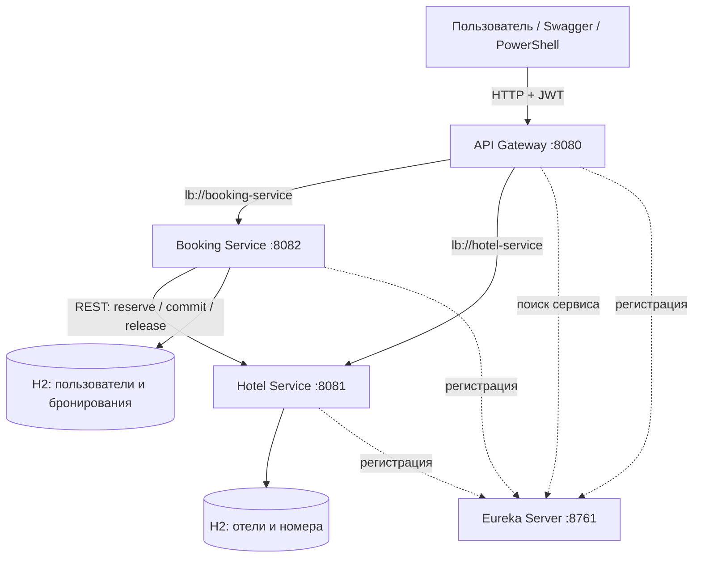
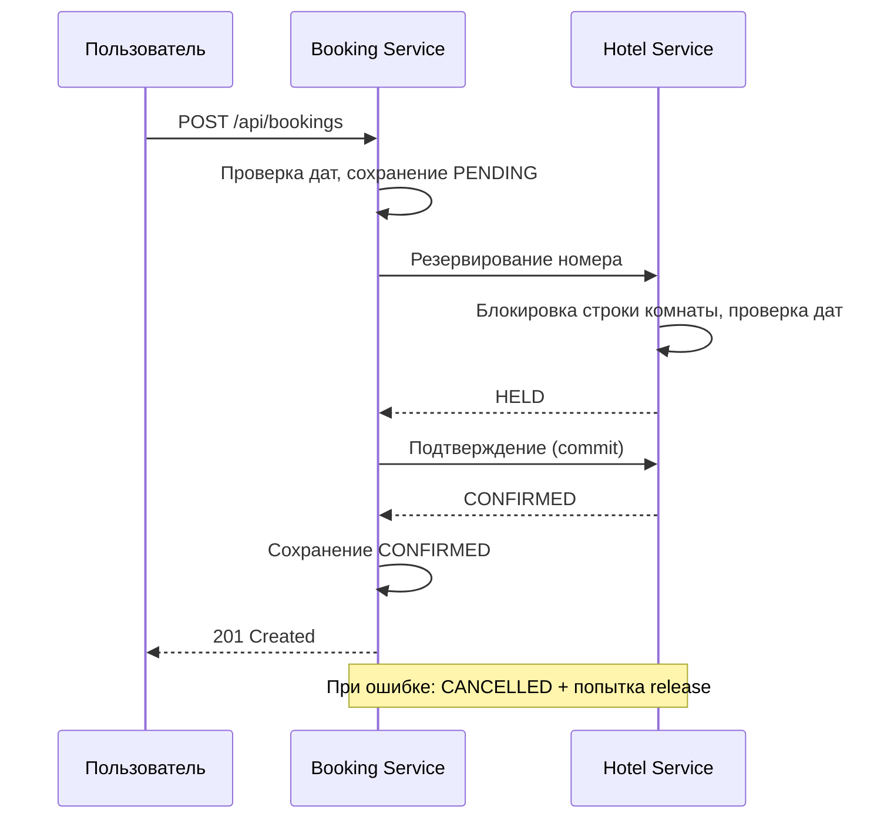
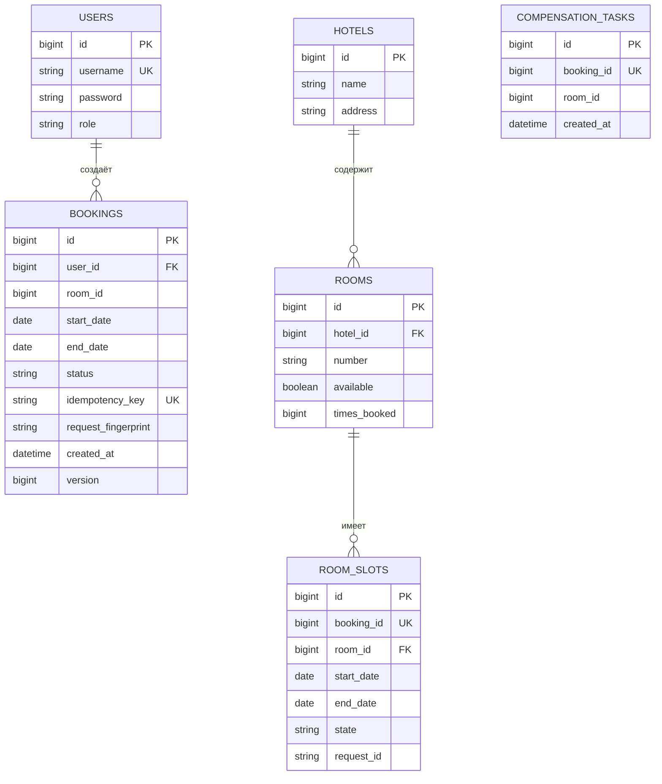

# Система бронирования отелей
REST API-приложение на Java 17, Spring Boot и Spring Cloud. Проект построен из нескольких микросервисов: один отвечает за отели и номера, другой за пользователей и бронирования. Для маршрутизации используется API Gateway, а для обнаружения сервисов используется Eureka.
Система позволяет регистрировать пользователей, находить свободные номера, создавать и отменять бронирования. Предусмотрены JWT-авторизация, роли `USER` и `ADMIN`, защита от повторных запросов и параллельного бронирования одного номера.

## Используемые технологии

- Java 17, Spring Boot 3.5, Spring Cloud, Maven;
- Spring Web / WebFlux, Spring Data JPA, Spring Security;
- Netflix Eureka, Spring Cloud Gateway и LoadBalancer;
- H2 Database (отдельная база в памяти у каждого бизнес-сервиса);
- JWT, BCrypt, Resilience4j (Retry и CircuitBreaker);
- Swagger / OpenAPI, JUnit 5, Mockito, MockMvc.

## Структура проекта

```text
hotel-booking-student/
├── discovery-server/       # реестр микросервисов
├── api-gateway/            # единая точка входа
├── hotel-service/          # отели, номера и занятые даты
├── booking-service/        # пользователи и бронирования
├── .github/workflows/      # автоматическая сборка и тесты
├── demo.ps1                # демонстрация основных действий
├── parallel_booking_test.ps1  # проверка параллельных запросов
├── pom.xml                 # общий Maven-проект
└── README.md
```

| Приложение | Порт | Назначение |
| --- | ---: | --- |
| `discovery-server` | 8761 | Регистрирует сервисы в Eureka, позволяет находить их поимени. |
| `api-gateway` | 8080 | Принимает внешние запросы, проверяет JWT и направляет запрос в нужный сервис. |
| `hotel-service` | 8081 | Хранит отели и номера, определяет свободные даты, резервирует и освободжает номера. |
| `booking-service` | 8082 | Регистрирует пользователей, выдаёт JWT, создаёт и отменяет бронирования. |

## Архитектура



Каждый бизнес-сервис использует свою H2 и изменяет только собственные данные. Booking Service не обращается напрямую к таблицам Hotel Service, для этого предусмотрены HTTP-запросы. Eureka хранит адреса работающих сервисов, а Gateway использует их имена для маршрутизации.

### Как устроен Java-код

Используется простое разделение **Controller -- > Service -- > Repository**:

- `Controller` принимает HTTP-запрос и возвращает ответ;
- `Service` проверяет данные и выполняет основную логику;
- `Repository` работает с таблицами через Spring Data JPA;
- классы `Booking`, `User`, `Hotel`, `Room`, `RoomSlot` описывают сущности базы;
- DTO (`BookingDtos`, `HotelDtos`) отделяют формат API от сущностей;
- `SecurityConfiguration` и `JwtTokens` отвечают за доступ и токены.

Основные файлы для чтения кода: `BookingController`, `BookingService`, `BookingTransactions`, `HotelClient`, `HotelService`, `SlotService`, `RoomRepository` и `BookingFlowTest`. Класс `BookingTransactions` выделен отдельно, чтобы не держать транзакцию с базой открытой во время сетевого вызова.

## Запуск на Windows

Нужны JDK 17, IntelliJ IDEA и Maven 3.9 (можно использовать Maven, встроенный в IntelliJ). Для баз данных не требуется отдельно устанавливать H2 или Docker.

1. Откройте корневую папку проекта в IntelliJ IDEA. В ней находится общий `pom.xml`.
2. В `File --> Project Structure` установи JDK 17. Обнови Maven-проект через Reload All Maven Projects.
3. Выполни в корне проекта команду:

```powershell
mvn clean verify
```

Если `mvn` не доступен в терминале, запустите `clean`, затем `verify` в панели Maven --> hotel-booking-platform --> Lifecycle. Успешная сборка заканчивается сообщением `BUILD SUCCESS`.

4. Запустите приложения по порядку, не останавливая предыдущие:
   - `DiscoveryApplication`;
   - `HotelApplication`;
   - `BookingApplication`;
   - `GatewayApplication`.

Каждый класс находится в соответствующем модуле в `src/main/java`. В IntelliJ его можно запустить зелёным треугольником рядом с методом `main`.

Вместо IntelliJ можно использовать четыре отдельных терминала в корне проекта:

```powershell
mvn -pl discovery-server spring-boot:run
mvn -pl hotel-service spring-boot:run
mvn -pl booking-service spring-boot:run
mvn -pl api-gateway spring-boot:run
```

5. Откройте Eureka Dashboard: http://localhost:8761. В списке должны появиться `HOTEL-SERVICE`, `BOOKING-SERVICE` и `API-GATEWAY` со статусом `UP`.

Другие полезные адреса:
API Gateway: http://localhost:8080
Swagger Hotel Service: http://localhost:8081/swagger-ui/index.html
Swagger Booking Service: http://localhost:8082/swagger-ui/index.html

В Swagger Booking Service доступна авторизация Bearer JWT через кнопку Authorize. Для ручной демонстрации Swagger обращается непосредственно к порту сервиса; внешним клиентам следует использовать Gateway (порт 8080).

### Тестовые пользователи

При запуске Booking Service создаются две учебные учётные записи:

| Логин | Пароль | Роль |
| --- | --- | --- |
| `demo` | `Demo12345!` | `USER` |
| `admin` | `Admin12345!` | `ADMIN` |

В Hotel Service создаются два вымышленных отеля (`North Hotel`, `River Hotel`) и несколько номеров. Названия и адреса нужны только для локального тестирования.

Учебные пароли и JWT-ключ предназначены только для демонстрации. В рабочем окружении нужно задавать их через переменные окружения (`DEMO_USER_PASSWORD`, `DEMO_ADMIN_PASSWORD`, `JWT_SECRET_BASE64`), а не хранить в открытом виде.

## Основные API-запросы

Все указанные ниже пути доступны через `http://localhost:8080` (API Gateway).

| Метод | Путь | Назначение | Доступ |
| --- | --- | --- | --- |
| `POST` | `/api/auth/register` | Регистрация пользователя | без токена |
| `POST` | `/api/auth/login` | Вход и получение JWT | без токена |
| `GET` | `/api/hotels` | Список отелей | USER / ADMIN |
| `POST` | `/api/hotels` | Создать отель | ADMIN |
| `PATCH` | `/api/hotels/{id}` | Изменить отель | ADMIN |
| `DELETE` | `/api/hotels/{id}` | Удалить отель | ADMIN |
| `GET` | `/api/rooms?startDate=...&endDate=...` | Свободные номера на даты | USER / ADMIN |
| `GET` | `/api/rooms/recommend?startDate=...&endDate=...` | Рекомендуемые номера | USER / ADMIN |
| `GET` | `/api/rooms/stats` | Статистика по номерам | ADMIN |
| `POST` | `/api/rooms` | Создать номер | ADMIN |
| `PATCH` | `/api/rooms/{id}` | Изменить номер | ADMIN |
| `DELETE` | `/api/rooms/{id}` | Удалить номер | ADMIN |
| `POST` | `/api/bookings` | Создать бронирование | USER / ADMIN |
| `GET` | `/api/bookings?page=0&size=20` | История бронирований пользователя | USER / ADMIN |
| `GET` | `/api/bookings/{id}` | Получить бронирование | владелец / ADMIN |
| `DELETE` | `/api/bookings/{id}` | Отменить бронирование | владелец / ADMIN |
| `GET` | `/api/users` | Список пользователей | ADMIN |

Технические методы Hotel Service (`confirm-availability`, `commit`, `release`) предназначены для взаимодействия сервисов с ролью `SERVICE` и не открыты через Gateway.

### Вход и JWT

```http
POST http://localhost:8080/api/auth/login
Content-Type: application/json

{
  "username": "demo",
  "password": "Demo12345!"
}
```

Сервис возвращает `accessToken`, `tokenType` и `expiresInSeconds` (3600 секунд). Для защищённых запросов передаётся заголовок:

```http
Authorization: Bearer <accessToken>
```

### Создание бронирования

Пример запроса на конкретный номер:

```http
POST http://localhost:8080/api/bookings
Authorization: Bearer <accessToken>
Idempotency-Key: booking-example-001
Content-Type: application/json

{
  "startDate": "2027-07-14",
  "endDate": "2027-07-17",
  "roomId": 1,
  "hotelId": 1,
  "autoSelect": false
}
```

Пример с автоматическим выбором:

```json
{
  "startDate": "2027-07-14",
  "endDate": "2027-07-17",
  "roomId": null,
  "hotelId": 1,
  "autoSelect": true
}
```

При `autoSelect: true` система получает список свободных номеров и выбирает первый подходящий. Если `hotelId` не указан, поиск может идти по всем отелям. `endDate`  дата выезда и не входит в занятый период. Например, брони 14–17 и 17–18 июля не пересекаются.

Успешное создание возвращает 201 Created, `id` и статус `CONFIRMED`. Повторный запрос с тем же `Idempotency-Key` и теми же параметрами возвращает существующую бронь; если параметры отличаются, то возникает конфликт `409`.

### HTTP-коды ошибок

| Код | Значение |
| --- | --- |
| `400` | Неверные входные данные или даты. |
| `401` | Нет действующего токена / неверные учётные данные. |
| `403` | Недостаточно прав для операции. |
| `404` | Запись не найдена или недоступна пользователю. |
| `409` | Номер занят или запрос конфликтует с уже существующим. |
| `503` | Невозможно завершить операцию из-за недоступности другого сервиса. |

Ответы об ошибках содержат сообщение и идентификатор трассировки `traceId` (когда он доступен).

## Логика бронирования



Защита от двойного бронирования. В `SlotService.reserve()` используется блокировка строки номера (`PESSIMISTIC_WRITE`). После получения блокировки сервис проверяет, что на даты нет пересекающихся `RoomSlot`. При конкурирующих запросах один может зарезервировать номер, а другой получит `409 Conflict`.

Рекомендации.`HotelService.listAvailable()` выбирает доступные на нужные даты номера и сортирует их по `timesBooked` (по возрастанию), затем по `id`. Счётчик увеличивается при подтверждении и уменьшается при отмене, поэтому в этой реализации он отражает количество подтверждённых бронирований с учётом отмен, а не неизменяемую историческую статистику.

Отказоустойчивость. В `HotelClient` используются Resilience4j Retry и CircuitBreaker; сетевые тайм-ауты настраиваются в `ClientConfiguration`. Если подтверждение не удалось, Booking Service переводит бронь в `CANCELLED` и запрашивает освобождение номера. Неудачные компенсации сохраняются как `CompensationTask`; `CompensationWorker` повторяет их по расписанию. Это упрощённая схема Saga с компенсирующими действиями, без общей транзакции между двумя базами.

Для корреляции логов Gateway передаёт заголовок `X-Trace-Id`, который используется в логировании сервисов.

## Модель данных

У каждого бизнес-сервиса своя база H2. Таблицы создаются Hibernate при запуске.



Сущности `USERS`, `BOOKINGS`, `COMPENSATION_TASKS` находятся в Booking Service; `HOTELS`, `ROOMS`, `ROOM_SLOTS` находятся в Hotel Service. Связи `bookings.room_id` и `room_slots.booking_id`  логические идентификаторы между сервисами, не внешние ключи между двумя базами.

`rooms.available` отвечает за общую доступность номера (например, не закрыт ли он на ремонт). Занятость на конкретный период определяется по `room_slots`. Для ускорения поиска в сущностях заданы индексы по номеру и датам, у номера уникальна пара `(hotel_id, number)`.

## Проверка работы

### Автоматические тесты

Из корня проекта:

```powershell
mvn clean verify
```

Тесты расположены в:

- `booking-service/src/test` — создание и повтор брони, ошибки связи, права доступа, автоматический подбор, компенсация,
- `hotel-service/src/test` — пересечение дат, повторное подтверждение, рекомендации, конкурентные запросы и HTTP-безопасность.

В репозитории настроен GitHub Actions (`.github/workflows/build.yml`), запускающий `mvn -B clean verify` при push и pull request.

### Демонстрация через PowerShell

Оставив все четыре приложения запущенными, выполните:

```powershell
powershell -NoProfile -ExecutionPolicy Bypass -File .\demo.ps1
```

Скрипт входит под `demo`, получает отели и доступные номера, создаёт бронь, повторяет запрос с тем же ключом и отменяет её. При успехе выводится сообщение `SUCCESS. Booking confirmed, duplicate prevented, booking cancelled.`

Для отдельной проверки двух конкурирующих пользователей:

```powershell
powershell -NoProfile -ExecutionPolicy Bypass -File .\parallel_booking_test.ps1
```

Оба пользователя пытаются занять один номер на одинаковые даты. Нормальный результат: **один `201 CONFIRMED`, второй `409`**.

### Ручные сценарии через Swagger

1. **Бронирование.** Войти под `demo`, получить JWT, выполнить `POST /api/bookings` на свободные даты. Ответ `201`, статус `CONFIRMED`.
2. **Идемпотентность.** Повторить запрос с теми же данными и `Idempotency-Key`: должен вернуться прежний `id`. С другим телом и прежним ключом `409`.
3. **Конфликт дат.** Указать уже занятый `roomId` и пересекающийся период, но новый ключ. Ответ `409`.
4. **Отмена.** Выполнить `DELETE /api/bookings/{id}`; ответ содержит `CANCELLED`. Даты затем можно использовать для нового бронирования.
5. **Права.** Без токена защищённый API возвращает `401`. Под `demo` запрос `GET /api/users` возвращает `403`, под `admin`, соотвественно, `200`.
6. **Недоступность Hotel Service.** Остановить только `HotelApplication`, выполнить новый запрос на конкретный номер. Booking Service возвращает `503`; в истории появляется отменённая бронь `CANCELLED`. Затем снова запустить Hotel Service. Этот сценарий показывает обработку отказа, но сам по себе не доказывает все случаи восстановления после потери данных.
7. **Граница дат.** Бронирования одного номера с датой выезда первого, равной дате заезда второго, должны проходить без конфликта.

## Ограничения

- H2 работает в памяти: после остановки каждого сервиса его данные удаляются. Поэтому после перезапуска Hotel и Booking их состояния могут расходиться.
- Нет механизма автоматического истечения старых `HELD`-слотов; для длительной эксплуатации понадобится их очистка.
- Фоновая компенсация хранится в той же H2 и не переживает рестарт Booking Service. В рабочем решении нужна постоянная БД либо надёжная очередь сообщений.
- Реальная оплата и пользовательский веб-интерфейс не реализованы: проект предоставляет REST API и Swagger.
- Демонстрационные учётные записи и секрет JWT подходят только для локального запуска.
